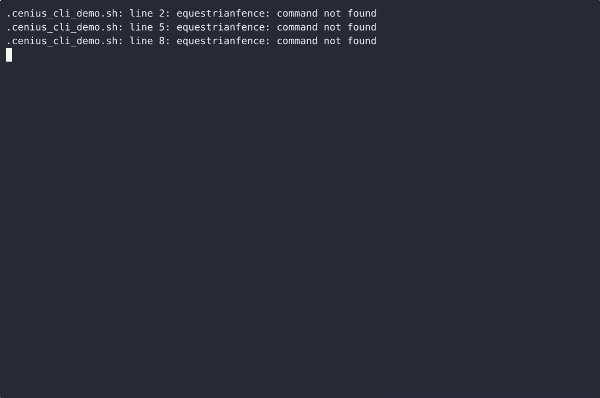
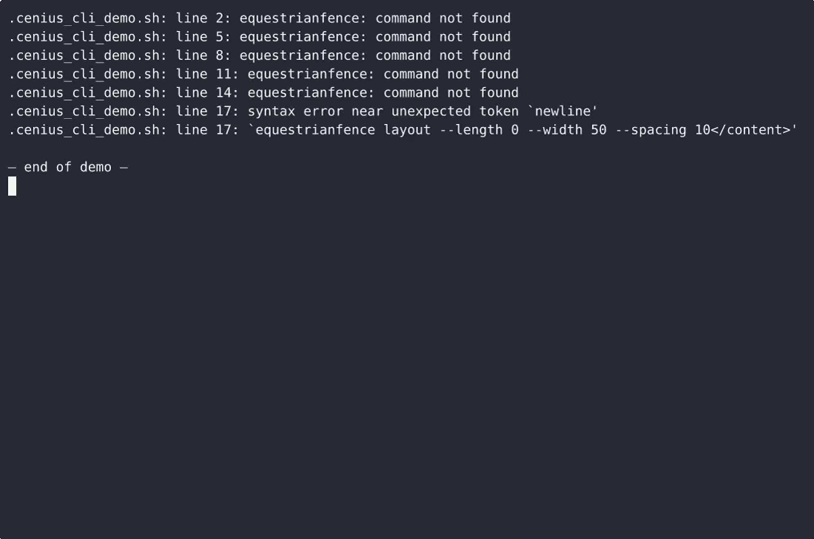

# EquestrianFence — complete Full-stack app command-line tool example app

This repository contains the complete source for **EquestrianFence**, an open-source command-line tool built with Full-stack app. Phase 1 ships the complete small MVP: a single-file, standard-library-only Python CLI that computes rectangular horse-pasture fence run layouts, calculates post spacing and counts, and prints a gate placement checklist. Everything EquestrianFence needs to run is here — code, seed data, install scripts. Apache-2.0-licensed — use EquestrianFence commercially, self-host it, or [remix EquestrianFence on cenius.ai](https://cenius.ai/marketplace/p/equestrianfence?ref=gh&utm_campaign=equestrianfence-webapp) to make it yours.


[](LICENSE)  [](https://cenius.ai)

[](https://cenius.ai/marketplace/p/equestrianfence?ref=gh&utm_campaign=equestrianfence-webapp)

> **▶ [Open & edit in cenius.ai](https://cenius.ai/marketplace/p/equestrianfence?ref=gh&utm_campaign=equestrianfence-webapp)** — one click to an editable workspace: describe changes in plain English, get an instant preview, one-click deploy and host. Modifications made on the platform come with full rebrand & relicense rights.

_Local clone? See [Quick start](#quick-start) below. cenius.ai is the zero-setup path._

## Demo


▶ **[Watch the full demo video](https://cenius.ai/marketplace/p/equestrianfence?ref=gh&utm_campaign=equestrianfence-webapp)** — the complete walkthrough, playing on the project's cenius.ai page · [MP4 file](.github/media/demo.mp4)

## Screenshots

 

## Architecture

A self-contained Full-stack app project (24 files): top-level directories include `examples/`, `tests/`. `install.sh` takes care of packages and initial data in a single pass; nothing else is required before launching. For environment-specific setup, see [`INSTALL.md`](INSTALL.md).

## Features

- Fence run layout
- Post spacing calculator
- Gate placement checklist

## Quick start

```bash
./install.sh   # installs dependencies + seeds demo data
```

See [`INSTALL.md`](INSTALL.md) for full setup and usage instructions.

## Usage guide

Three subcommands, one unit (feet), one rectangle. Every command prints its
answer to stdout, exits `0`, and writes nothing to disk.

```bash
python3 equestrian_fence.py --help
python3 equestrian_fence.py layout    --length 100 --width 50  --spacing 10
python3 equestrian_fence.py spacing   --run 100    --spacing 12
python3 equestrian_fence.py checklist --gates 2    --gate-width 12
```

After `bash install.sh` you can drop `python3 equestrian_fence.py` for the
console script: `equestrianfence layout --length 100 --width 50 --spacing 10`.

---

### 1. Fence run layout — `layout`

> "I have a 100 × 50 ft paddock and posts every 10 ft. How many runs, how much
> perimeter, how many posts do I buy?"

```bash
python3 equestrian_fence.py layout --length 100 --width 50 --spacing 10
```

```
equestrianfence layout

  Pasture           100 ft x 50 ft
  Post spacing      10 ft

Runs
+-------+------+----+--------+----------+
| Run   | From | To | Length | Segments |
+-------+------+----+--------+----------+
| North | NW   | NE | 100 ft | 10       |
| East  | NE   | SE | 50 ft  | 5        |
| South | SE   | SW | 100 ft | 10       |
| West  | SW   | NW | 50 ft  | 5        |
| Total |      |    | 300 ft |          |
+-------+------+----+--------+----------+

Perimeter: 300 ft
Posts: 30
  (34 run-end posts minus the 4 shared corners, counted once)

Posts per run include both end corners, so buy 30 posts for the loop, not 34.
```

**The arithmetic, spelled out.**

_Full guide: [`USAGE.md`](USAGE.md)_

## FAQ

### What's the quickest way to self-host EquestrianFence?

Grab the repo and run `./install.sh` — it handles packages and seed data in one go. After that, [`INSTALL.md`](INSTALL.md) walks you through starting the server. No external accounts required.

### What powers EquestrianFence under the hood?

The app is built with Full-stack app. What you see in this repo is the full production source, demo data included. Highlights include fence run layout.

### Is white-labeling EquestrianFence allowed?

Rebranding is straightforward under the MIT license — change what you want in the source. Or [open it on cenius.ai](https://cenius.ai/marketplace/p/equestrianfence?ref=gh&utm_campaign=equestrianfence-webapp): the platform handles the changes and grants full rebrand rights on the result.

### Is EquestrianFence free for commercial use?

The code is under the Apache-2.0 license, which allows commercial use without restriction. You can build, sell, and deploy it freely. Full text: [LICENSE](LICENSE).

### Can non-developers customise EquestrianFence?

Yes — [load it on cenius.ai](https://cenius.ai/marketplace/p/equestrianfence?ref=gh&utm_campaign=equestrianfence-webapp), describe the change in plain English, and you get back a fresh build with your modification applied.

## License & rebranding

Released under the [Apache License 2.0](LICENSE) (© 2026 Cenius AI) — free for personal and commercial use. The Cenius name/logo are trademarks (see NOTICE).

**Need a customized version?** [Remix this app on cenius.ai](https://cenius.ai/marketplace/p/equestrianfence?ref=gh&utm_campaign=equestrianfence-webapp) — modifications made on the platform come with **full rebrand & relicense rights** over your derivative.

## Built with cenius.ai

This entire application — code, design, seeded demo data — was generated on **[cenius.ai](https://cenius.ai)** from a plain-English description.

- 🚀 [Build your own app on cenius.ai](https://cenius.ai)
- 🎛️ [Remix EquestrianFence on the marketplace](https://cenius.ai/marketplace/p/equestrianfence?ref=gh&utm_campaign=equestrianfence-webapp) — open it in a workspace, prompt for changes, and ship your own version.

More open-source apps: [the Cenius-ai catalog](https://github.com/Cenius-ai) · [showcase index](https://github.com/Cenius-ai/showcase)
